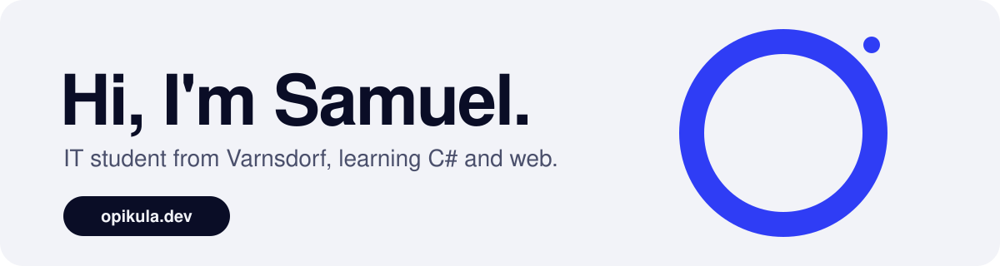

 

---

## About me

I'm Samuel Pelc, and I study IT in Varnsdorf. It's exactly where I want to be, even if I sometimes miss elementary school. My current passion is **C#**, though that might change.

| Study | Right now | Outside the code |
| :--- | :--- | :--- |
| IT in Varnsdorf | Learning C# | Video games, friends, anime, and going outside (sometimes) |

---

## Learning and exploring

| | Skill | Where I'm at |
| :---: | :--- | :--- |
|  | **C#** | My main focus. It's fun and interesting, and sometimes painful. |
|  | **Python** | The main language at school. Simple, and great for beginners. |
|  | **HTML** | The easiest of the web basics for me so far. |
|  | **CSS** | Pretty fun, especially when one change makes a whole site look different. |
|  | **JavaScript** | Frustrating for now, but I'll get there. |
|  | **SQL** | Just the basics so far, and I hope to learn more. |
|  | **Batch** | Not a real programming language, but I love making programs and games with it. |
|  | **Cybersecurity** | Still exploring. All the malware I've had makes me doubt it's for me. |

---

## GitHub stats

  

  

 

Check out my friends' sites too: [Spagy](https://github.com/Spagy69) and [Kralyk](https://kralyk.dev/). See what I've built at [opikula.dev](https://opikula.dev/projects.html).
